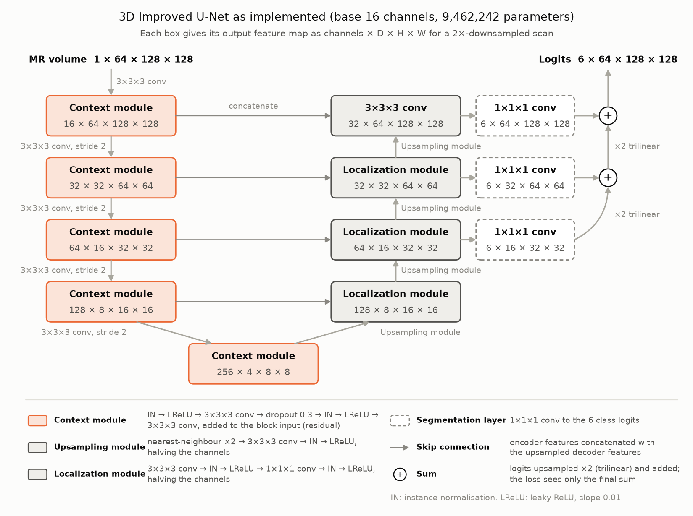
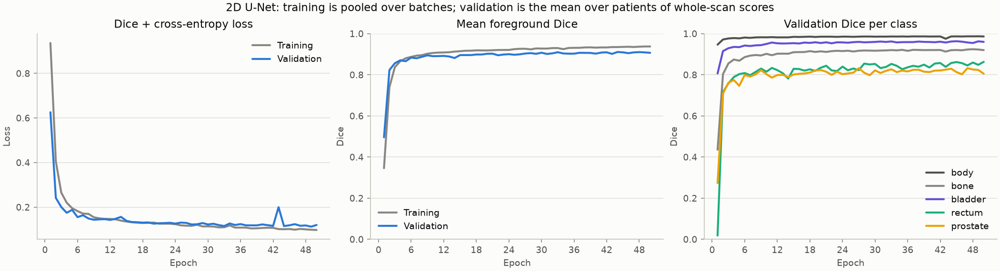
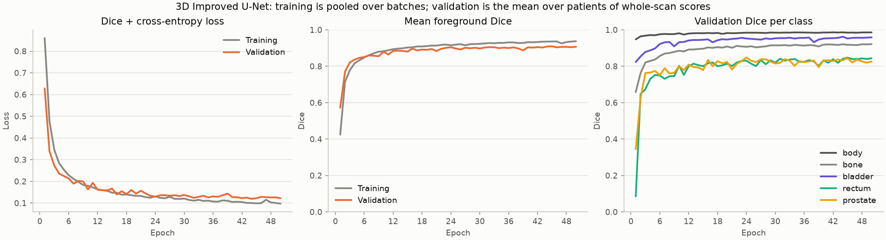
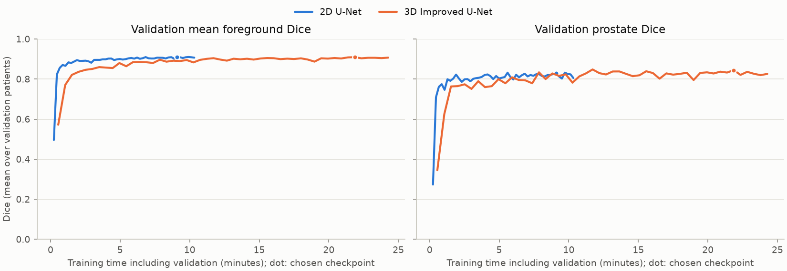
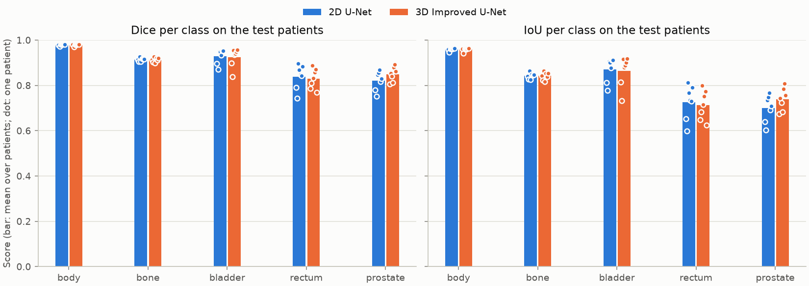
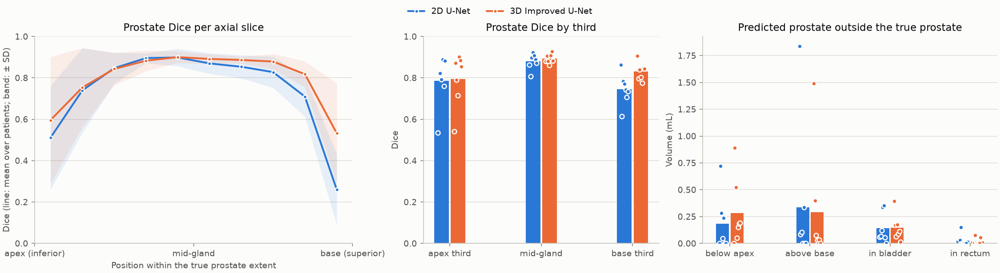
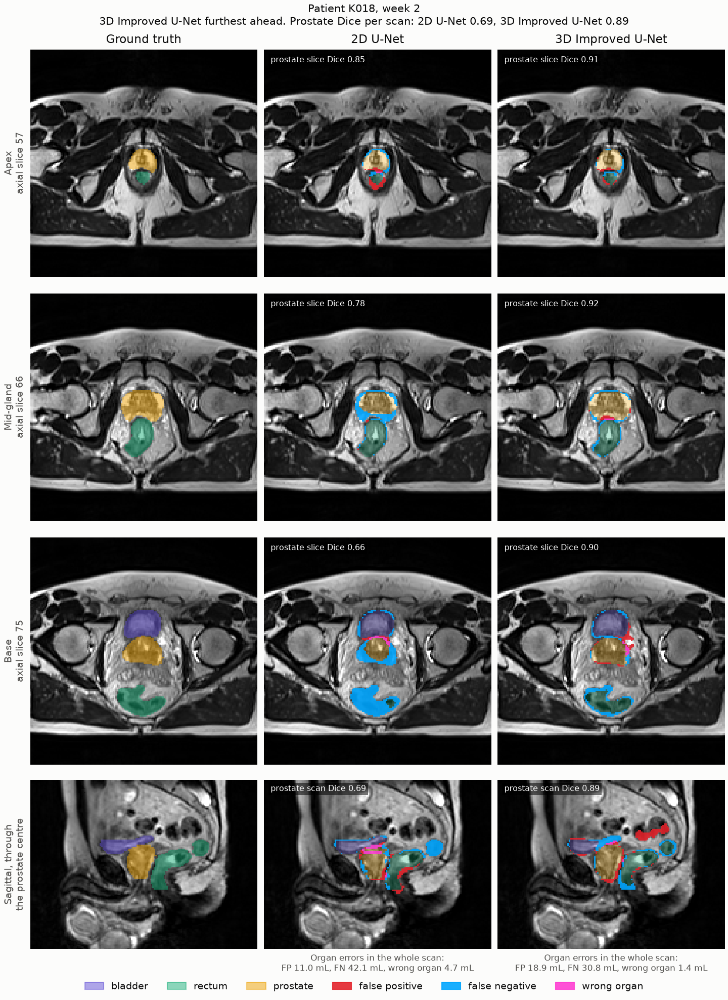
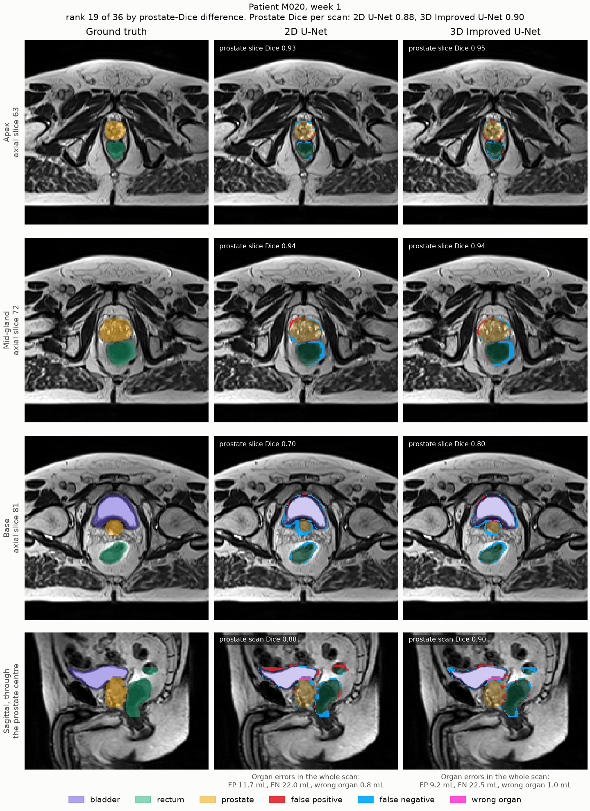
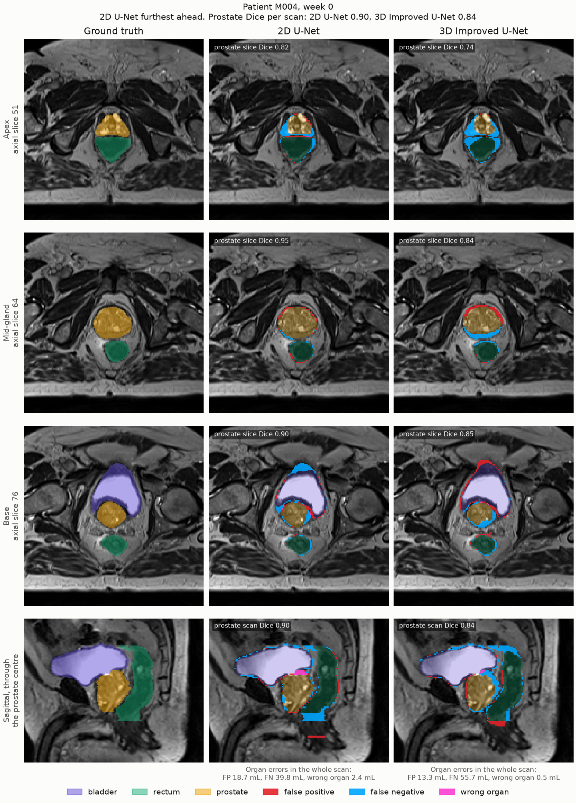

# 3D Improved U-Net for HipMRI Image Segmentation
**Task:** 2.2 Anatomical Contouring and Radiotherapy Planning | **Chosen model:** 3D Improved U-Net | **Author:** Einar Fugle


## Contents
- [1. Problem and Objectives](#1-problem-and-objectives)
- [2. Dataset and Preprocessing](#2-dataset-and-preprocessing)
- [3. Method and Model Architecture](#3-method-and-model-architecture)
- [4. Experimental Setup](#4-experimental-setup)
- [5. Experiments and Model Development](#5-experiments-and-model-development)
- [6. Results](#6-results)
- [7. Discussion and Limitations](#7-discussion-and-limitations)
- [8. Conclusion and Recommendation](#8-conclusion-and-recommendation)
- [9. Reproducibility](#9-reproducibility)
- [10. Feasibility Review](#10-feasibility-review-improved-3d-u-net-for-prostate-mri-segmentation-23-october-2026)
- [11. References](#11-references)
- [12. Artificial Intelligence Usage Disclosure](#12-artificial-intelligence-usage-disclosure)


## 1. Problem and Objectives
This project addresses Task 2.2 by developing a 3D Improved U-Net to segment the prostate and surrounding pelvic structures from downsampled HipMRI volumes, producing draft contours for specialist review in radiotherapy planning. The main question is whether 3D spatial context improves segmentation at the prostate base and apex and reduces incorrect prostate predictions within the bladder and rectum compared with a standard 2D U-Net—and whether these improvements justify the additional computation.

Both models will use the same patient-level split and preprocessing, with the 2D baseline operating on axial slices from the same volumes. The objectives are to achieve a test Dice score of at least 0.70 for each foreground class, match or improve the baseline’s base/apex performance, and reduce organ-interface errors. Evaluation will combine per-class Dice and IoU, visual analysis of 3–5 boundary failure cases, and measurements of training time, peak GPU memory and per-volume inference time.

## 2. Dataset and Preprocessing 

### 2.1 HipMRI prostate MRI data

The HipMRI study (Dowling & Greer, 2021) contains 211 pelvic MR volumes from 38 prostate radiotherapy patients, each scanned at up to eight weekly time points (`Week0`–`Week7`). 22 patients have all eight scans, 11 have a single scan and 5 have two to seven. On Rangpur the data live in `/home/groups/comp3710/HipMRI_Study_open`:

| Folder | Content |
|---|---|
| `semantic_MRs/` | MR volumes named `<patient>_Week<n>_LFOV.nii.gz`, e.g. `B006_Week0_LFOV.nii.gz` |
| `semantic_labels_only/` | One label volume per MR volume, matched by patient and week |

The loader also accepts the anonymised naming of the public release (`Case_004_Week0_LFOV.nii.gz`). 210 volumes are 256 × 256 × 128 voxels and one is 256 × 256 × 144. The slice spacing is 1.56 mm, and the in-plane spacing is 1.41–1.88 mm (mostly 1.68 mm). All volumes are stored left–posterior–superior (LPS).

| Label ID | 0 | 1 | 2 | 3 | 4 | 5 |
|---|---|---|---|---|---|---|
| Structure | background | body outline | bone | bladder | rectum | prostate |

Both models read the same 3D volumes: the 3D model sees whole volumes and the 2D baseline sees their axial slices. The two models get the same patients, intensities and voxel grid, and one evaluation can score both on full test volumes. The feasibility baseline in Section 10 was trained on the keras slices. Its loader has since been removed, and its results are kept only as a pipeline check.

### 2.3 Patient-level split

- **Unit of splitting.** All scans of a patient go into the same split. The patient ID is the part of the file name before `_Week`. Weekly scans of one patient are near-duplicates, so splitting by scan would leak information into validation and test.
- **Sizes.** `make_patient_split()` (seed 42) assigns 26 / 5 / 7 patients to train / validation / test. Single-scan patients (11) and patients with a weekly series (27) are shuffled separately, and validation and test places are shared between the groups in proportion to their size. This gives 8 / 1 / 2 single-scan and 18 / 4 / 5 series patients.
- **One fixed split for everything.** The first `train.py` run on Rangpur writes the split to `patient_split.json`. The file is then committed and read by every training and evaluation script. `save_split()` never overwrites an existing file, so the test set cannot change after results have been seen. Loading checks that every patient is in exactly one split and that no ID is unknown, so a split made from a different copy of the data fails immediately.

### 2.4 Preprocessing

`load_scan()` applies the same steps to every scan, for both models:

1. **Pairing and checks.** The MR and label volumes of a scan must have the same shape and affine. MR intensities must be finite, and labels must be integers from 0 to 5. Any failure stops loading.
2. **Orientation.** Each scan is reoriented to RAS with `nibabel.as_closest_canonical` (axis flips and permutations only, no resampling). It is then laid out as `[D, H, W]`: D runs inferior→superior, so `volume[d]` is an axial slice; H runs posterior→anterior and W left→right.
3. **Downsampling** of every axis by an integer factor *f*, as the brief asks for downsampled 3D data. The default, `DEFAULT_DOWNSAMPLE = 2`, turns 256 × 256 × 128 voxels into 128 × 128 × 64 at roughly 3.1–3.4 mm. That gives the 3D model eight times fewer voxels, and gives the 2D baseline 64 axial slices of 128 × 128 per scan. `--downsample 1` keeps full resolution.
   - MR volumes use the block mean.
   - Labels use a majority vote within each *f* × *f* × *f* block. A tie goes to the label of the voxel that nearest-exact sampling picks from the block.

   On three checked scans, always giving ties to the lower label ID shrank organs by 3–7 %. The rule above keeps every structure within about 2 % of its original volume. Scans are not resampled to a common spacing. `load_scan()` returns each scan's voxel spacing, for boundary metrics in millimetres.
4. **Intensity normalisation.** Each MR volume is z-scored with its own mean and standard deviation, after any downsampling. No statistics are shared between scans or splits. The 2D baseline uses these per-volume statistics, not per-slice ones, so both models see identical intensities.
5. **Datasets.**
   - `VolumeDataset` returns whole scans for the 3D model: images `[1, D, H, W]` and labels `[D, H, W]`. Scans differ in size, so use batch size 1 or crop them.
   - `AxialSliceDataset` returns every axial slice of the same preprocessed scans for the 2D baseline: images `[1, H, W]` and labels `[H, W]`. It keeps the scans in memory: about 5 MB each at the default factor, or 40 MB at full resolution.

**Augmentation (training data only).** `Augmentation` applies the same random transforms to both models' training samples. The 3D model gets one draw per scan, so all its slices move together; the 2D model gets one draw per slice. Validation and test data are never augmented.

| Transform | Setting |
| --- | --- |
| Left–right flip | Probability 0.5 |
| Rotation and scaling in the axial plane | Probability 0.5; rotation up to ±10°, scale 0.9–1.1. The MR is interpolated bilinearly and the labels by nearest neighbour, so they stay aligned. |
| Intensity | Contrast × 0.9–1.1, brightness ± 0.1 (in z-score units), Gaussian noise with SD up to 0.05 |

Flips along the other two axes are left out because they would put the bladder below or behind the prostate. Only in-plane transforms are used, so the 2D and 3D models see the same kinds of variation.

## 3. Method and Model Architecture

### 3.1 End-to-end pipeline

Both models turn a scan into a label map in the same four steps:

1. **Preprocessing.** `load_scan()` (Section 2.4) checks the MR and label files, reorients them to RAS, downsamples them 2× and z-scores the MR. The result is an image of 1 × 64 × 128 × 128.
2. **Model.** The 3D model takes the whole volume in one forward pass. The 2D baseline takes the 64 axial slices, each 1 × 128 × 128, and its slice outputs are stacked back into a volume.
3. **Resampling.** A softmax turns the 6 class logits into probabilities, which are resampled trilinearly to the scan's original grid, typically 128 × 256 × 256.
4. **Decision.** Each voxel gets its most probable class. There is no threshold and no postprocessing.



*The 3D Improved U-Net as implemented in `modules.py`, after Isensee et al. (2018).*
- *Encoder (orange): stride-2 3×3×3 convolutions halve the resolution four times while the channels double from 16 to 256. Each level ends in a residual context module.*
- *Decoder (grey): each level upsamples, concatenates the encoder features of the same level, and reduces them with a localization module.*
- *Deep supervision: segmentation layers on the three highest decoder levels are upsampled and summed into the output, and the loss is applied only to this sum.*
- *Shapes: measured with a forward pass on a 2×-downsampled scan.*

The role of each component:

- **Stride-2 convolutions** downsample with learned weights instead of max pooling. Each deeper level sees a larger part of the scan at a coarser resolution.
- **Context modules** extract the features at each level. The pre-activation residual connection eases training, and dropout regularises the model.
- **Upsampling and localization modules** bring the coarse features back up and combine them with the same-level encoder features from the skip connections. This recovers the boundary detail lost by downsampling.
- **Instance normalisation and leaky ReLU** come before each convolution in the context modules and after each convolution in the decoder. Instance normalisation works with one scan per batch, where batch normalisation would have a single sample to estimate its statistics from.
- **Deep supervision** adds the segmentations of the two coarser decoder levels to the final one. The loss gradient therefore reaches those levels directly.

### 3.2 Baseline and final model

The baseline, `UNet2D`, is a standard U-Net (Ronneberger et al., 2015) with padded convolutions. Each level has two 3×3 convolutions with ReLU; downsampling is 2×2 max pooling, and upsampling is bilinear, followed by concatenation with the skip. The final model, `ImprovedUNet3D`, follows Isensee et al. (2018) as shown above. Both are trained from scratch, without pretrained weights.

| | 2D U-Net baseline | 3D Improved U-Net |
| --- | --- | --- |
| Input → output | One axial slice, 1 × 128 × 128 → 6 × 128 × 128 | Whole scan, 1 × 64 × 128 × 128 → 6 × 64 × 128 × 128 |
| Convolutions | 3×3 (2D) | 3×3×3 (3D) |
| Spatial context | One slice; nothing from the slices above or below | The whole scan, including neighbouring slices |
| Down- / upsampling | Max pooling / bilinear | Stride-2 convolution / nearest neighbour + convolution |
| Blocks | Two convolutions per level | Residual context modules, localization modules |
| Normalisation, activation | None, ReLU | Instance normalisation, leaky ReLU (0.01) |
| Regularisation | None | Dropout 0.3 in the context modules |
| Output | Last decoder level | Sum of three decoder levels (deep supervision) |
| Channels over 5 levels | 32 → 512 | 16 → 256 |
| Parameters | 7,846,246 | 9,462,242 |
| Peak training memory | 0.88 GiB (16 slices per batch) | 2.17 GiB (1 scan per batch) |

**Memory implications.** A 3D feature map holds every slice at once, so the 3D model trains on one scan per batch with half the base width of the 2D model. On the 2×-downsampled grid this still costs only 2.5× the 2D model's memory. At full resolution the activations would grow 8×.

Because blocks, width and learning rate change together with dimensionality, the comparison is between two configurations, not a test of 3D context alone.

### 3.3 Loss and inference

**Loss.** Both models use `DiceCELoss` (`utils.py`): cross-entropy plus soft Dice loss, with weights 1 : 1 and no class weights.

- **Cross-entropy** covers all 6 classes and is averaged over voxels.
- **Soft Dice** is computed per foreground class (labels 1–5) from the softmax probabilities *p* and one-hot labels *g*, summed over the batch and all voxels: Dice = (2Σ*pg* + ε) / (Σ*p* + Σ*g* + ε), with ε = 10⁻⁶. The Dice loss is 1 minus the mean Dice over the classes present in the batch's labels.
- **Absent classes** are left out of the Dice mean, so a 2D batch without prostate does not add a near-constant term to the loss. Cross-entropy still penalises predicting a class that is absent.
- **Class imbalance.** The Dice term counters it, because the prostate counts as much as the body regardless of its size (Section 2.1).

The reported metrics differ from the training loss. The loss uses soft probabilities pooled over a batch. Validation and test Dice and IoU use the arg-max labels, scored per class and per scan and averaged per patient (Section 4.2).

**Inference.** `predict.py` and the test step of `train.py` both use `utils.predict_scan`, which follows the pipeline in Section 3.1:

1. **Loading.** The model is rebuilt from the settings stored in `best.pt` and put in evaluation mode, which turns dropout off. `predict.py` also refuses a checkpoint whose stored split includes a test patient.
2. **Forward pass.** The 3D model predicts the whole volume at once, without patches or a sliding window. The 2D model predicts the slices in batches of 32 and stacks them back in order.
3. **Output.** The decision rule is the arg-max over the probabilities resampled to full resolution. There is no threshold, test-time augmentation or postprocessing such as keeping the largest connected component.

## 4. Experimental Setup

### 4.1 Training configuration

Both models were trained twice on Rangpur with `train.py`, on the same patient split and the same 2×-downsampled scans (Section 2): run 1 without augmentation and run 2 with it. Nothing else changed between the runs, and run 2 is the final configuration (Section 5). The settings that differ between the models are explained below the table.

| Setting | 2D Baseline | 3D Improved U-Net |
| --- | --- | --- |
| Configuration / run ID | Run 1: `train.py --model unet2d --downsample 2 --no-augment`, output in `runs/unet2d`. Run 2: `train.py --model unet2d --downsample 2 --output-dir runs/unet2d_aug` | Run 1: `train.py --model improved3d --downsample 2 --no-augment`, output in `runs/improved3d`. Run 2: `train.py --model improved3d --downsample 2 --output-dir runs/improved3d_aug` |
| Model size | 32 base channels, 7,846,246 parameters | 16 base channels, 9,462,242 parameters |
| Input or patch size | Axial slices, 1 × 128 × 128 (64 per scan) | Whole scans, 1 × 64 × 128 × 128 (one scan 1 × 72 × 128 × 128); no patches |
| Optimizer and weight decay | Adam, weight decay 1 × 10⁻⁵ | Adam, weight decay 1 × 10⁻⁵ |
| Initial learning rate | 1 × 10⁻³ | 5 × 10⁻⁴ |
| Scheduler and parameters | Exponential decay, × 0.985 per epoch (4.8 × 10⁻⁴ at epoch 50) | Exponential decay, × 0.985 per epoch (2.4 × 10⁻⁴ at epoch 50) |
| Batch size / accumulation | 16 slices, no accumulation (≈ 570 steps per epoch) | 1 scan, no accumulation (142 steps per epoch) |
| Loss and term weights | Cross-entropy + soft Dice over the foreground classes present in the batch, weights 1 : 1 | Same |
| Augmentation | Run 1: none. Run 2: in-plane flips, rotation, scaling and intensity changes (Section 2.4), one draw per slice | Run 1: none. Run 2: the same transforms, one draw per scan |
| Completed epochs | 50 | 50 |
| Checkpoint selection rule | Highest validation mean foreground Dice; epoch 34 (run 1), 44 (run 2) | Same; epoch 42 (run 1), 45 (run 2) |
| Early stopping | None | None |
| Random seeds / number of runs | Seed 42 for the split, initialisation and data order; 1 run per configuration | Seed 42; 1 run per configuration |
| Precision, GPU and memory | FP32 on one NVIDIA A100-PCIE-40GB; peak allocated 0.88 GiB in both runs | FP32, same GPU; peak allocated 2.17 GiB in both runs |
| Training time (including validation) | 10.6 min in both runs (≈ 12 s per epoch) | 23.6 min (run 1), 24.6 min (run 2) (≈ 28–29 s per epoch) |

- **Learning rate.** The 3D model uses the initial rate and decay of Isensee et al. (2018): 5 × 10⁻⁴, decayed × 0.985 per epoch. The 2D baseline keeps the 1 × 10⁻³ of the feasibility run.
- **Batch size.** Scans differ in depth, so the 3D model trains on one whole scan per step. The 2D model takes 16 slices from mixed scans per step, so it makes about four times as many optimizer steps per epoch. Both models see every training voxel once per epoch.
- **Checkpoint selection.** After every epoch, each model predicts all 33 validation scans, the 2D model slice by slice. The kept checkpoint has the highest mean foreground Dice, averaged per scan and then over the 5 validation patients, on the downsampled grid.
- **Fixed budget.** Both models train for 50 epochs without early stopping, in both runs. cuDNN was not forced to be deterministic, so a rerun with the same seed can differ slightly.
- **Augmentation.** Run 2 applies the transforms of Section 2.4 to the training data only. They run on the fly in the data loader and add about 1 s per epoch for the 3D model and nothing measurable for the 2D model.

### 4.2 Evaluation protocol

- **Data and checkpoints.** The test split has 7 patients and 36 scans, with 1, 8, 8, 8, 4, 6 and 1 scans per patient. It was scored once per run, with each model's `best.pt` (`train.py` and `predict.py` give identical scores), and played no part in training or checkpoint selection. Augmentation was planned from the run-1 validation curves and kept because validation favoured it for both models (Section 5).
- **Full-resolution scoring.** Each model predicts on its 2×-downsampled input, the 2D model slice by slice with the slices stacked back into a volume. The softmax probabilities are resampled trilinearly to the scan's original label grid, typically 128 × 256 × 256 voxels, before the arg-max. Both models are therefore scored against the original labels on exactly the same voxels.
- **Dice and IoU.** Both are computed per class and per scan (whole volume) from a confusion matrix, and higher is better:
  - Dice = 2TP / (2TP + FP + FN)
  - IoU = TP / (TP + FP + FN)

  Background is excluded from the foreground mean. A class absent from both the prediction and the truth of a scan is undefined and left out of every average. A class that is predicted but absent from the truth scores 0.
- **Aggregation.** Each patient's scans are averaged first. The mean and sample SD across the 7 patients are then reported, so a patient with eight weekly scans counts once. Dice pooled over all test voxels is given for reference.
- **Prostate along the head–foot axis.**
  - The true prostate's axial extent is split into thirds: apex (inferior third), mid-gland (middle third) and base (superior third). Dice is computed over the slices of each third, and per slice along the whole extent.
  - False positives are reported as predicted prostate volume in mL, from the voxel spacing: below the apex, above the base, and inside the true bladder and rectum.
  - True prostate assigned to other classes is read from the confusion matrices in `metrics.json`.
- **Paired comparison.** Per-patient differences (3D − 2D, or run 2 − run 1) are tested with an exact two-sided sign-flip test over all 2⁷ = 128 sign patterns; the smallest possible p is 0.016. These tests are exploratory and not corrected for multiple comparisons.
- **Cost.**
  - Training time covers the training and validation loop.
  - Memory is peak PyTorch-allocated CUDA memory.
  - Inference time is the CUDA-synchronised forward pass for one scan: the median over 36 scans after one warm-up scan, excluding loading and resampling.
- **What differs between models and runs.** Subjects, preprocessing, epochs and metric code are identical throughout. The models, learning rates and batch composition differ (Section 4.1); between run 1 and run 2 only augmentation changes. There was one training run per model and configuration, so the reported SDs describe variation between patients, not between training runs.
- **Validation versus test.** Validation scores are computed on the downsampled grid and are not directly comparable with the full-resolution test scores.

## 5. Experiments and Model Development

The first comparison followed an audit of the feasibility pipeline, which changed the data set-up before any 3D training. Validation results guided the design. The test split was scored once after each run, and Section 6 reports both runs.

| Experiment | Hypothesis / change from baseline | Validation result | Cost or trade-off | Decision |
| --- | --- | --- | --- | --- |
| Feasibility pilot: 2D U-Net on the course's 2D slices (Section 10) | Check the data pipeline and metrics before 3D work | Mean foreground Dice 0.911, pooled over slices | 12.9 min, 0.75 GiB | Superseded. Used the larger HipMRI 2D dataset where the slices are coronal, so base and apex lie inside each slice. The 3-patient test set was 78 % one patient, and pooled Dice hid errors at the ends of the prostate.|
| 2D U-Net baseline run (`runs/unet2d`) | Reference: a standard 2D U-Net on axial slices of the 2×-downsampled scans | Mean foreground Dice 0.909, prostate 0.829 (epoch 34) | 10.6 min, 0.88 GiB | Reference in run 1 |
| 3D Improved U-Net, no augmentation (`runs/improved3d`) | Whole-scan context, together with residual context modules, instance normalisation and deep supervision, should reduce slice-transition errors at the prostate base and apex | Mean foreground Dice 0.908, prostate 0.830 (epoch 42) | 23.6 min (2.2×), 2.17 GiB (2.5×) | Used as 3D model in run 1 without augmentation. |
| Run 2: augmentation, both models (`runs/unet2d_aug`, `runs/improved3d_aug`) | In-plane augmentation (Section 2.4) should narrow the train–validation gap (0.955 vs 0.908 foreground Dice at the selected epochs). Everything else stays as in run 1, so the change from run 1 isolates the effect of augmentation. | 2D: 0.911, prostate 0.830 (epoch 44). 3D: 0.909, prostate 0.845 (epoch 45). The gap at the selected epochs narrows to 0.935 vs 0.911 (2D) and 0.936 vs 0.909 (3D). The lowest validation loss falls from 0.120 to 0.113 (2D) and from 0.123 to 0.119 (3D). | No extra memory; training time unchanged (2D) and +4 % (3D) | Kept as final for both models, since validation is slightly better for both. Run 2 is used for the final comparison. |

The split, preprocessing, downsampling, loss, optimizer type, weight decay, learning-rate decay, epoch budget, seed, checkpoint rule and evaluation code were held constant. Between runs 1 and 2 only augmentation changed. The models still differ in dimensionality, in the Improved U-Net blocks (residual context modules, instance normalisation, leaky ReLU, dropout, deep supervision), in channel width, learning rate and batch composition. The 2D-versus-3D comparison is therefore a comparison of two complete configurations.


## 6. Results

### 6.1 Training behaviour

| Validation, foreground Dice unless stated | 2D run 1 | 2D run 2 | 3D run 1 | 3D run 2 |
| --- | ---: | ---: | ---: | ---: |
| Selected epoch | 34 | 44 | 42 | 45 |
| Training / validation at the selected epoch | 0.954 / 0.909 | 0.935 / 0.911 | 0.955 / 0.908 | 0.936 / 0.909 |
| Training / validation at epoch 50 | 0.965 / 0.906 | 0.938 / 0.907 | 0.959 / 0.905 | 0.937 / 0.907 |
| Validation prostate Dice at the selected epoch | 0.829 | 0.830 | 0.830 | 0.845 |
| Lowest validation loss (epoch) | 0.120 (34) | 0.113 (49) | 0.123 (32) | 0.119 (44) |
| First epoch above 0.90 | 16 | 20 | 22 | 23 |

Augmentation roughly halves the gap between training and validation Dice, while validation Dice stays the same or rises slightly. With augmentation, validation loss is still lowest at epochs 44–49, so 50 epochs may now be too few. The figures show run 2.



*2D U-Net, run 2. The training and validation curves stay close, and validation Dice levels off from about epoch 20. Selected checkpoint: epoch 44.*



*3D Improved U-Net, run 2. It converges more slowly than the 2D model and levels off at the same validation Dice. Selected checkpoint: epoch 45.*



*Validation Dice against training time, run 2; dots mark the selected checkpoints. The 2D model reaches its plateau after about 4 minutes, the 3D model after about 11.*

### 6.2 Quantitative results

All test values are the mean ± SD over the 7 test patients (36 scans), scored against the full-resolution labels. Run 2 (with augmentation) is the final comparison.

| Model / run | Test mean foreground Dice | Test prostate Dice | Training / inference cost |
| --- | ---: | ---: | --- |
| 2D U-Net, run 1 (`runs/unet2d`, epoch 34) | 0.893 ± 0.021 | 0.821 ± 0.049 | 10.6 min, 0.88 GiB peak; 51 ms and 814 MiB per scan |
| 3D Improved U-Net, run 1 (`runs/improved3d`, epoch 42) | 0.895 ± 0.026 | 0.832 ± 0.032 | 23.6 min, 2.17 GiB peak; 21 ms and 686 MiB per scan |
| **2D U-Net baseline, run 2** (`runs/unet2d_aug`, epoch 44) | 0.897 ± 0.026 | 0.821 ± 0.042 | 10.6 min, 0.88 GiB peak; 52 ms and 814 MiB per scan |
| **3D Improved U-Net, run 2 (final)** (`runs/improved3d_aug`, epoch 45) | 0.899 ± 0.019 | 0.849 ± 0.032 | 24.6 min, 2.17 GiB peak; 21 ms and 686 MiB per scan |

Per class in run 2, with the 2D U-Net as baseline and the 3D Improved U-Net as final model:

| Class / organ | Baseline Dice | Final Dice | Baseline IoU | Final IoU | Dice ≥ 0.70 met? |
| --- | ---: | ---: | ---: | ---: | --- |
| Body | 0.980 ± 0.003 | 0.979 ± 0.004 | 0.960 | 0.959 | Yes, both |
| Bone | 0.914 ± 0.008 | 0.914 ± 0.010 | 0.842 | 0.842 | Yes, both |
| Bladder | 0.930 ± 0.033 | 0.924 ± 0.043 | 0.871 | 0.864 | Yes, both |
| Rectum | 0.839 ± 0.054 | 0.831 ± 0.044 | 0.727 | 0.714 | Yes, both |
| Prostate | 0.821 ± 0.042 | 0.849 ± 0.032 | 0.699 | 0.739 | Yes, both |
| Foreground mean | 0.897 ± 0.026 | 0.899 ± 0.019 | 0.820 | 0.824 | Yes, both |

Only the prostate separates the models. The 3D model is ahead in 5 of 7 patients (+0.028, p = 0.22). The other classes differ by at most 0.008, and each model wins in 3–4 patients. Pooled over all test voxels, every class is within 0.017 of its patient mean.

Along the prostate, run 2:

| Prostate measure | 2D U-Net | 3D Improved U-Net | 3D − 2D, paired over 7 patients |
| --- | ---: | ---: | --- |
| Apex third, Dice | 0.786 ± 0.120 | 0.794 ± 0.129 | +0.008; 3D better in 4 of 7 (p = 0.77) |
| Mid-gland, Dice | 0.880 ± 0.038 | 0.892 ± 0.022 | +0.012; 3D better in 4 of 7 (p = 0.56) |
| Base third, Dice | 0.745 ± 0.076 | 0.830 ± 0.044 | +0.085; 3D better in 7 of 7 (p = 0.016) and in 32 of 36 scans |
| Scans with base / apex third Dice < 0.5 | 2 / 0 | 0 / 0 | |
| True prostate recovered (mL, of 42.7) | 32.2 | 34.4 | |
| True prostate labelled bladder / body (mL) | 1.15 / 9.25 | 0.62 / 7.59 | Scans with > 1 mL labelled bladder: 18 vs 5 |
| Predicted prostate below apex / above base (mL) | 0.18 / 0.34 | 0.28 / 0.29 | |
| Predicted prostate inside bladder / rectum / body (mL) | 0.14 / 0.03 / 3.18 | 0.15 / 0.02 / 4.59 | |

The 3D model is better at the base in every patient and recovers more of the prostate, at the cost of slightly more prostate predicted in the surrounding tissue.



*Dice and IoU per foreground class, run 2. Bars are patient means; dots are individual patients. Only the prostate separates the models, and the patient ranges still overlap.*



*Prostate Dice along the head–foot axis (left), per third (middle), and predicted prostate outside the true prostate (right), run 2. The curves are close from the apex to the mid-gland and separate towards the base: in the top 20 % of the prostate the 3D model scores 0.82 and 0.53, against 0.71 and 0.26. Both models are weakest at the apex tip (0.60 and 0.51).*

### 6.3 Example segmentations

`predict.py` ranks the test scans by the difference in whole-scan prostate Dice and shows the scan where the 3D model is furthest ahead, the median scan and the scan where the 2D model is furthest ahead, so the cases are not hand-picked. Each figure shows axial slices at the centre of the apex, mid-gland and base thirds, over about 27 cm of the pelvis, plus a sagittal cut through the whole scan. The model columns fill correctly labelled organs and mark the errors: red for false positives, blue for false negatives and magenta for one organ predicted as another.



*Largest 3D advantage (K018 week 2; prostate Dice 0.69 vs 0.89). Near the base, the 2D U-Net labels part of the prostate as bladder (magenta in its base slice and sagittal cut) and misses the prostate's edge (blue), giving base-third Dice of 0.37 against 0.90. Neighbouring slices let the 3D model separate prostate from bladder at the bladder neck.*



*Median scan (M020 week 1; prostate Dice 0.88 vs 0.90). The models agree at the apex and mid-gland. At the base, both miss part of the small prostate cross-section under the bladder (blue): on a typical scan the models differ little, and the missed boundary is shared.*



*Largest 2D advantage (M004 week 0; prostate Dice 0.90 vs 0.84). In the mid-gland, the 3D model's prostate extends past its anterior edge (red) and leaves a gap along the posterior edge against the rectum (blue; slice Dice 0.84 vs 0.95). M004 is the test patient where the 3D model falls furthest behind the 2D model: whole-scan context does not prevent errors at the prostate–rectum interface.*

### 6.4 Acceptance criteria

Results for the final run 2, against the criteria in Section 10.1:

| Criterion | Result |
| --- | --- |
| 1. Test Dice ≥ 0.70 for each foreground class | Met. The lowest classes are the prostate for the 2D model (0.821) and the rectum for the 3D model (0.831). |
| 2. Prostate base/apex Dice at least matches the baseline | Met on the patient mean. The base is better in all 7 patients (0.830 vs 0.745), the apex in only 4 (0.794 vs 0.786). |
| 3. Fewer prostate false positives inside bladder/rectum | Both models predict under 0.2 mL of prostate inside these organs (bladder 0.15 vs 0.14 mL, rectum 0.02 vs 0.03 mL). |
| 4. Training fits one A100 40 GB at batch size 1; memory and inference time measured | Met. 2.17 GiB peak training memory and 21 ms per scan at inference. |

## 7. Discussion and Limitations

### 7.1 Interpretation

The main advantage of the 3D Improved U-Net was concentrated at the prostate base. It more often retained prostate tissue near the bladder neck, reducing its misclassification as bladder. This regional improvement explains why the 3D configuration may be useful even though the difference in mean foreground Dice was small.

The advantage was less consistent elsewhere. Apex performance remained variable, and the mid-gland ranking reversed between the unaugmented and augmented configurations. Both models continued to miss tissue along the outer prostate boundary. In the augmented comparison, the 3D model recovered more true prostate but also predicted more prostate in surrounding tissue. The original objective of reducing prostate false positives inside the bladder and rectum was not demonstrated.

Augmentation produced slightly higher validation scores and a smaller reported training–validation gap. This is consistent with a regularising effect, but training used augmented examples and a different metric aggregation from validation. The gap therefore does not directly quantify reduced overfitting. With one training run per configuration, the contribution of training variability also remains uncertain.

The shared boundary errors may reflect the coarse working grid, limited training data and ambiguous image contrast. These explanations are plausible but were not tested separately.

### 7.2 Limitations

- Small evaluation sample. The 36 test scans came from seven patients. Patient-level averaging prevents patients with more scans from dominating the results, but the independent evaluation sample remains small.

- Unmeasured training variability. Each configuration was trained once on one split. The statistical tests describe differences between patients, not variation across training runs. Their p-values are exploratory and uncorrected for multiple comparisons.

- Several model differences. Dimensionality, architecture blocks, width, learning rate and batch composition changed together. The observed improvement belongs to the complete 3D Improved U-Net configuration and cannot be attributed to spatial context alone.

- Repeated test evaluation. Run-1 test results were seen before run 2 was trained. Augmentation was selected using validation evidence, and both runs are reported, but the test set was not untouched throughout development.

- Resolution and measurement scope. Both models predicted on downsampled scans before their probabilities were resampled to the original grid. Inference timings cover the forward pass only, and memory measurements cover PyTorch-allocated GPU memory. Effects on clinical review time or treatment planning were not measured.

### 7.3 Next experiments

1. **Full resolution (`--downsample 1`)** for both models, to test whether the coarse grid causes the shared boundary and apex errors. Scaling the measured 2.17 GiB by the 8× voxel count gives roughly 17 GiB for the 3D model, which fits the A100.
2. **A longer epoch budget with augmentation**, since validation loss was still lowest at epochs 44–49 of 50.
3. **A 2D Improved U-Net** with the same blocks and 2D convolutions, to separate the effect of 3D context from the architecture.

## 8. Conclusion and Recommendation

On whole-scan Dice the 3D Improved U-Net and the 2D U-Net baseline are close: they are level for body, bone, bladder and rectum, and the 3D model's higher prostate Dice (0.849 vs 0.821) is not consistent across the 7 test patients. 3D context does not merely smooth the easy central slices, where the models are level; its gain is at a slice transition. At the prostate base the 3D model is better in every test patient (0.830 vs 0.745) and roughly halves the prostate labelled as bladder. It does not eliminate boundary errors: both models still miss the outer boundary and the apex tip, and the 3D model is weaker at the prostate–rectum interface. The cost is well below the anticipated 5–10×: 2.3× the training time and 2.5× the memory, with faster inference.

For a draft-contouring pipeline at this resolution, the 3D Improved U-Net justifies its cost. Training is a one-off 25 minutes on one A100, inference is cheaper per scan, and the gain falls on the prostate base, where the 2D model failed most. Its contours still need specialist review at the apex, the outer boundary and the prostate–rectum interface. The evidence rests on one split and one run per configuration, and it supports the 3D Improved U-Net as a whole rather than 3D context alone. Multi-scale dilation was not tested, so this project gives no evidence on it.

## 9. Reproducibility

### 9.1 Files and responsibilities

| File / directory | Responsibility |
| --- | --- |
| `modules.py` | `UNet2D` baseline, and `ImprovedUNet3D` with its context, down-sampling, up-sampling and output blocks |
| `dataset.py` | Scan discovery and pairing, the patient split, `load_scan()` preprocessing, `Augmentation`, `VolumeDataset` and `AxialSliceDataset`. Run directly to create or check the split. |
| `utils.py` | Model registry, Dice + cross-entropy loss, confusion-matrix Dice and IoU, regional prostate scores, patient-level summaries, whole-scan prediction with resampling to full resolution, timing and memory helpers |
| `train.py` | Training, per-epoch validation, checkpoint selection and the test evaluation of the selected checkpoint |
| `predict.py` | Evaluation of one to three checkpoints on the test patients, with the comparison tables and figures |
| `test_dataset.py`, `test_baseline.py` | 20 unit tests on synthetic data: loading, split, augmentation, models, loss and metrics |
| `patient_split.json` | The fixed 26 / 5 / 7 patient split used for every reported result |
| `requirements.txt` | Python dependencies |
| `visualizations/` | Figures used in this report (`run1_*`, `run2_*`) |
| `runs/`, `predictions/` | Training and evaluation outputs; not in the repository |

There are no configuration files. Every setting is a command-line flag whose default is the value in Section 4.1, and each run records its flags in `results.json`.

### 9.2 Environment

- **Tested setup.** The reported runs used one NVIDIA A100-PCIE-40GB on Rangpur, with PyTorch 2.14.0 and CUDA 13.0, as recorded in each `results.json`. `requirements.txt` pins the versions used for the local checks with Python 3.12: torch, nibabel, numpy and matplotlib.
- **Hardware.** At the default 2× downsampling, training needs about 0.9 GiB (2D) or 2.2 GiB (3D) of GPU memory.

### 9.3 Data and split

- **Data.** On Rangpur the scripts read `/home/groups/comp3710/HipMRI_Study_open`, with MR volumes in `semantic_MRs/` and label volumes in `semantic_labels_only/` (Section 2.1). Both are NIfTI (`.nii.gz`), and the labels are integers 0–5 on the MR grid. For another location, use `--data-root`, `--image-dir` and `--label-dir` (`train.py`, `predict.py`) or `--root` (`dataset.py`).
- **Split.** All scripts read `patient_split.json` from this directory (`--split-file` to change it). If the file is missing, the first `train.py` run creates it with seed 42.

  ```bash
  python dataset.py --write-split   # create the split without training
  python dataset.py                 # check the saved split against the data
  ```

  The file is never overwritten. It uses the Rangpur patient IDs. The anonymised public release (`Case_…`) has different IDs, so it needs its own split file.

### 9.4 Reproducing the reported results

Run from this directory on a GPU node:

```bash
# Run 1: no augmentation
python train.py --model unet2d --no-augment
python train.py --model improved3d --no-augment
python predict.py --checkpoints runs/unet2d/best.pt runs/improved3d/best.pt --output-dir "predictions/3D&2D_run"

# Run 2 (final): with augmentation
python train.py --model unet2d --output-dir runs/unet2d_aug
python train.py --model improved3d --output-dir runs/improved3d_aug
python predict.py --checkpoints runs/unet2d_aug/best.pt runs/improved3d_aug/best.pt --output-dir predictions/aug_run
```

- **Defaults and output folders.** The defaults need no flags: 2× downsampling, 50 epochs, seed 42, augmentation on, and the learning rates of Section 4.1. `python train.py --help` lists them. Give every run its own `--output-dir`: the default folders `runs/<model>` and `predictions/` are overwritten without warning.
- **Outputs.**
  - `train.py` writes `best.pt`, `history.json` (scores per epoch), `results.json` (settings, cost and test scores) and `curves.png`.
  - `predict.py` writes `metrics.json`, `scan_scores.csv` and the figures of Section 6. It refuses a checkpoint whose stored split puts a test patient in training or validation.
- **Determinism.** Training took about 11 min (2D) and 25 min (3D) on the A100. cuDNN is not deterministic, so retrained scores can differ slightly from Section 6.
- **Smoke test.** `python train.py --model improved3d --epochs 1 --max-scans 4 --output-dir runs/smoke` runs the whole pipeline on a few scans per split.

### 9.5 Trained weights

The weights are not in the repository, because `*.pt` files are ignored; retrain them with the commands above. Each `best.pt` (31 MB for the 2D model, 38 MB for the 3D model) stores:
- the weights;
- the model type and settings;
- the downsampling factor;
- the patient split;
- the epoch.


## 10. Feasibility Review: Improved 3D U-Net for Prostate MRI Segmentation (23. October 2026)

*This is the feasibility review as submitted on 23 October 2026. Sections 2 and 5 describe what changed afterwards: the course's coronal 2D slices were replaced by axial slices of the 3D volumes, and the 31 / 4 / 3 split by a 26 / 5 / 7 split.*

**Project:** 2.2 Anatomical Contouring and Radiotherapy Planning | **Chosen model:** 3D Improved U-Net (Hard) | **Author:** Einar Fugle

### 10.1. User Need, Scope & Acceptance Criteria

**Intended user:** radiotherapy planners reviewing draft pelvic MRI contours. This prototype tests whether 3D context reduces prostate base/apex and organ-interface errors enough to justify extra compute. Contours require specialist review.

**Acceptance criteria for the 3D comparison:**

1. Held-out Dice ≥ 0.70 for each foreground class; report per-class Dice and IoU.
2. Prostate base/apex Dice at least matches the 2D baseline under the same region definitions.
3. Fewer prostate false-positive voxels within labelled bladder/rectum regions than the baseline.
4. Training fits one A100 40 GB GPU at batch size 1; measure peak VRAM and per-case inference time to assess the accuracy/compute trade-off.

### 10.2. Model Choice & Course Concepts

**Data:** HipMRI has 38 patients and 211 scans. Training/validation/test contain **31/4/3 patients** and **11,460/660/540 slices**, with no patient overlap. Baseline preprocessing uses per-slice z-score normalization, 256 × 128 resizing and nearest-neighbour masks. For the 3D model I will downsample the data to reduce compute time. The 2D vs 3D comparison will preserve patient groups and verify scan/label alignment.

**Models:** a standard [2D U-Net](https://arxiv.org/abs/1505.04597) establishes the baseline; [Improved 3D U-Net](https://arxiv.org/abs/1802.10508) adds volumetric context, residual units and deep supervision. Course concepts include encoder-decoders, skip connections, residual learning, Dice plus cross-entropy for class imbalance, and patient-independent validation.

### 10.3. Preliminary Feasibility Evidence

**Completed baseline testing:** A100-40GB, PyTorch, Adam 0.001, batch 8, seed 42. **15 epochs; best checkpoint: epoch 11.** Test evaluation covered 540 slices from nine scans and three patients.

| Baseline measurement | Result |
|---|---:|
| Best validation / test mean foreground Dice | 0.9109 / **0.9179** |
| Test mean foreground IoU | **0.8532** |
| Parameters | 7,846,246 |
| Training + validation time | 774.95 s (12.92 min; 0.215 GPU-hours) |
| Peak allocated VRAM: training / inference | **0.746 / 0.079 GiB** |
| Mean forward time: slice / 60-slice scan | **2.38 ms / 0.143 s** |

| Test label ID | 0 (background) | 1 | 2 | 3 | 4 | 5 |
|---|---:|---:|---:|---:|---:|---:|
| Dice | 0.9963 | 0.9845 | 0.9364 | 0.9640 | 0.8415 | 0.8632 |
| IoU | 0.9926 | 0.9694 | 0.8804 | 0.9304 | 0.7264 | 0.7593 |

Scores pool pixels; foreground means average labels 1–5. Anatomical label names remain unverified. VRAM measures allocated tensors, not reserved GPU memory. Inference times cover synchronized forward passes only; training time includes validation/checkpointing. Sources: `runs/2d_unet/results.json`, `predictions/2d_unet/metrics.json`.


*Patient 040, week 4, slice 29. Red: false positive; blue: false negative; magenta: wrong foreground class. Boundary errors remain; base/apex performance and 3D benefit are untested.*

### 10.4. Risks, Budget & Fallback

| Risk | Mitigation |
|---|---|
| 3D memory or runtime exceeds resources | Measure a forward/backward pass first; use mixed precision, smaller patches and sliding-window inference. |
| Global Dice hides boundary errors | Define base/apex regions and inspect 3–5 paired failure cases with false-positive/negative overlays. |
| Small test cohort and repeated scans bias pooled scores | Add patient-level comparisons and preserve patient-disjoint splits. |
| HPC time limits interrupt experiments | Save checkpoints and test resume support before long 3D jobs. |

**Proposed budget:** 5–10 GPU-hours, refined after a pilot. **Next experiment:** verify anatomical labels and the 3D split, then measure a small Improved 3D U-Net training run. **Fallback:** reduce width/patch size, then consider a smaller standard 3D U-Net if necessary. Compare accuracy, GPU-hours, VRAM and latency under comparable checkpoint selection.


## 11. References


- Dowling, J., & Greer, P. (2021). *Labelled weekly MR images of the male pelvis* (Version 2) [Data set]. CSIRO. https://doi.org/10.25919/45t8-p065. Licence CC BY-NC-ND 4.0; no data are redistributed in this repository.

- Isensee, F., Kickingereder, P., Wick, W., Bendszus, M., & Maier-Hein, K. H. (2018). Brain tumor segmentation and radiomics survival prediction: Contribution to the BRATS 2017 challenge. In *Brainlesion: Glioma, Multiple Sclerosis, Stroke and Traumatic Brain Injuries (BrainLes 2017)*, Lecture Notes in Computer Science, vol. 10670, pp. 287–297. Springer. https://doi.org/10.1007/978-3-319-75238-9_25. Preprint: https://arxiv.org/abs/1802.10508

- Ronneberger, O., Fischer, P., & Brox, T. (2015). U-Net: Convolutional networks for biomedical image segmentation. In *Medical Image Computing and Computer-Assisted Intervention – MICCAI 2015*, Lecture Notes in Computer Science, vol. 9351, pp. 234–241. Springer. https://doi.org/10.1007/978-3-319-24574-4_28. Preprint: https://arxiv.org/abs/1505.04597

## 12. Artificial Intelligence Usage Disclosure

Artificial intelligence tools were utilized in the development and validation of this pipeline. OpenAI Codex was used for initial planning, code generation, and testing of the baseline 2D pipeline. Claude Code was used for auditing the feasibility pipeline (specifically identifying data leakage and metric errors), help with implementing the end-to-end 3D workflow (data loading, patient splitting, downsampling, augmentation, training/evaluation code, and unit testing), and analyzing experimental results.

AI-assisted code was manually reviewed, tested, and validated to ensure functionality, covering dataset loading, model outputs, and evaluation metrics. Performance was further assessed through segmentation outputs and detailed failure-case analysis to identify errors and guide targeted pipeline improvements.

