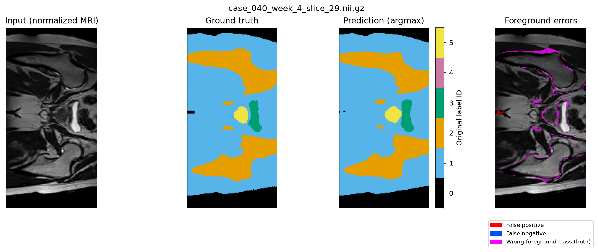

# Feasibility Review: Improved 3D U-Net for Prostate MRI Segmentation

**Project:** 2.2 Anatomical Contouring and Radiotherapy Planning | **Chosen model:** 3D Improved U-Net (Hard) | **Author:** Einar Fugle

## 1. User Need, Scope & Acceptance Criteria

**Intended user:** radiotherapy planners reviewing draft pelvic MRI contours. This prototype tests whether 3D context reduces prostate base/apex and organ-interface errors enough to justify extra compute. Contours require specialist review.

**Acceptance criteria for the 3D comparison:**

1. Held-out Dice ≥ 0.70 for each foreground class; report per-class Dice and IoU.
2. Prostate base/apex Dice at least matches the 2D baseline under the same region definitions.
3. Fewer prostate false-positive voxels within labelled bladder/rectum regions than the baseline.
4. Training fits one A100 40 GB GPU at batch size 1; measure peak VRAM and per-case inference time to assess the accuracy/compute trade-off.

## 2. Model Choice & Course Concepts

**Data:** HipMRI has 38 patients and 211 scans. Training/validation/test contain **31/4/3 patients** and **11,460/660/540 slices**, with no patient overlap. Baseline preprocessing uses per-slice z-score normalization, 256 × 128 resizing and nearest-neighbour masks. For the 3D model I will downsample the data to reduce compute time. The 2D vs 3D comparison will preserve patient groups and verify scan/label alignment.

**Models:** a standard [2D U-Net](https://arxiv.org/abs/1505.04597) establishes the baseline; [Improved 3D U-Net](https://arxiv.org/abs/1802.10508) adds volumetric context, residual units and deep supervision. Course concepts include encoder-decoders, skip connections, residual learning, Dice plus cross-entropy for class imbalance, and patient-independent validation.

## 3. Preliminary Feasibility Evidence

**Completed baseline testing:** A100-40GB, PyTorch, Adam 0.001, batch 8, seed 42. **15 epochs; best checkpoint: epoch 11.** Test evaluation covered 540 slices from nine scans and three patients.

| Baseline measurement | Result |
|---|---:|
| Best validation / test mean foreground Dice | 0.9109 / **0.9179** |
| Test mean foreground IoU | **0.8532** |
| Parameters | 7,846,246 |
| Training + validation time | 774.95 s (12.92 min; 0.215 GPU-hours) |
| Peak allocated VRAM: training / inference | **0.746 / 0.079 GiB** |
| Mean forward time: slice / 60-slice scan | **2.38 ms / 0.143 s** |

| Test label ID | 0 (background) | 1 | 2 | 3 | 4 | 5 |
|---|---:|---:|---:|---:|---:|---:|
| Dice | 0.9963 | 0.9845 | 0.9364 | 0.9640 | 0.8415 | 0.8632 |
| IoU | 0.9926 | 0.9694 | 0.8804 | 0.9304 | 0.7264 | 0.7593 |

Scores pool pixels; foreground means average labels 1–5. Anatomical label names remain unverified. VRAM measures allocated tensors, not reserved GPU memory. Inference times cover synchronized forward passes only; training time includes validation/checkpointing. Sources: `runs/2d_unet/results.json`, `predictions/2d_unet/metrics.json`.

*Patient 040, week 4, slice 29. Red: false positive; blue: false negative; magenta: wrong foreground class. Boundary errors remain; base/apex performance and 3D benefit are untested.*

## 4. Risks, Budget & Fallback

| Risk | Mitigation |
|---|---|
| 3D memory or runtime exceeds resources | Measure a forward/backward pass first; use mixed precision, smaller patches and sliding-window inference. |
| Global Dice hides boundary errors | Define base/apex regions and inspect 3–5 paired failure cases with false-positive/negative overlays. |
| Small test cohort and repeated scans bias pooled scores | Add patient-level comparisons and preserve patient-disjoint splits. |
| HPC time limits interrupt experiments | Save checkpoints and test resume support before long 3D jobs. |

**Proposed budget:** 5–10 GPU-hours, refined after a pilot. **Next experiment:** verify anatomical labels and the 3D split, then measure a small Improved 3D U-Net training run. **Fallback:** reduce width/patch size, then consider a smaller standard 3D U-Net if necessary. Compare accuracy, GPU-hours, VRAM and latency under comparable checkpoint selection.

### Artificial Intelligence Usage Disclosure

Codex assisted with planning, code and testing. Verification used analytical metrics, synthetic/real-data tests, checkpoint restoration, and inspection of HPC results and figures.
